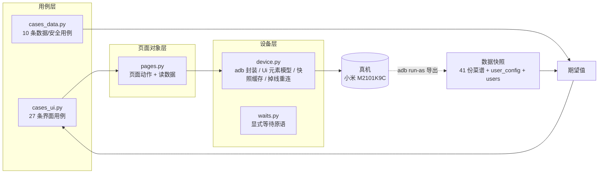
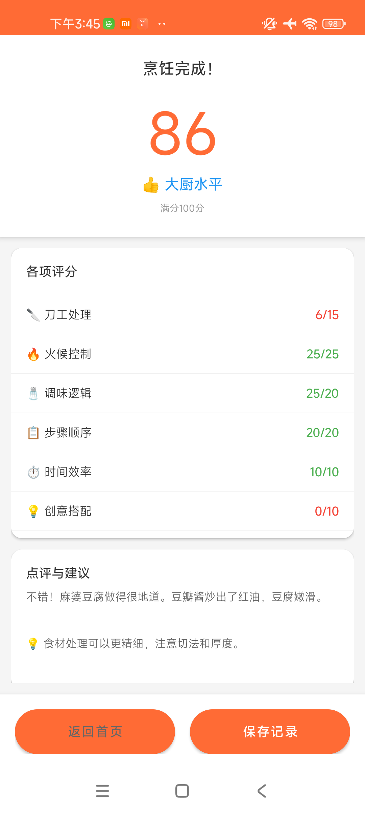

# 使用 AI 进行真机自动化回归

> **被测 App 由 AI 生成，测试同样由 AI 驱动。** 用 Python + adb 遥控一台真机，把 App 自己落盘的数据（41 份菜谱 JSON、用户配置、账号文件）当作"标准答案"，让断言从"界面看起来对不对"变成"界面显示与真实数据逐项对账"。


[](https://laai123.github.io/ai-real-device-regression/)

🔗 **在线测试报告**：<https://laai123.github.io/ai-real-device-regression/> <!-- 仓库改名后同步更新此链接 -->
（Allure 交互式报告，按功能分组、可展开每条用例看失败截图与界面树）

**2026.09 – 2026.10** · 37 条用例（27 条真机界面 + 10 条数据核对）· 检出 22 条缺陷 · 全量 10 分钟

---

## 一、项目速览

| 项 | 内容 |
|---|---|
| 被测应用 | 厨房小能手 `com.example.kitchenassistant` v1.0（minSdk 24 / targetSdk 34，debuggable） |
| 被测内容 | 启动与首页、菜谱分析（列表 / 分类 / 搜索 / 详情）、烹饪流程、打分结果页、厨房设置、个人信息 |
| 测试设备 | 小米 M2101K9C（1080×2400，density 440），**无线 adb** 真机 |
| 技术栈 | Python 标准库 + adb 命令行、pytest、allure-pytest、Allure 2.x |
| 用例规模 | 37 条：数据与安全 10 条 + 界面 27 条 |
| 执行结果 | **通过 13 / 失败 22 / 提示级 2**（22 条失败对应 22 条产品缺陷） |
| 全量耗时 | 1725 秒 → **595 秒**（2.9 倍提速，结论逐条一致） |
| 产出 | Allure HTML 报告 + Markdown 缺陷报告 + 失败截图/界面树证据 |

> 这里的"失败"不是脚本挂掉，而是**脚本稳定地跑出了产品的问题**——22 条失败在两次独立执行中编号、内容完全一致。

---

## 二、问题：只看界面的自动化，测不到真正的问题

被测 App 是 AI 一次性生成的：数据层（菜谱 JSON）和展示层（界面文案 / 算分逻辑）各写一份，没有任何机制保证两边一致。这类问题用传统 UI 自动化几乎测不出来：

- 列表页写着"共 **42** 道菜"，设备上实际只有 **41** 份数据文件，APK 里内置了 **46** 道——三个数字互不相同，但单纯点进去看，页面正常渲染、不报错、不崩溃；
- 结果页出现 `调味 25/20`、`时间效率 25/10`（得分率 150%、250%），控件树里只是几段普通文本，断言"元素存在"永远会通过；
- 3 个食材的 `options` 是空对象，界面却提示"请为每种食材选择处理方式"——视觉上像正常校验，实际用户被卡死。

**结论：界面层的"存在性断言"只能证明 App 没崩，证明不了 App 是对的。** 要检出这类缺陷，必须先拿到一份独立、可信的期望值。

---

## 三、核心思路：把 App 自己的数据变成"标准答案"

测试期间发现被测 App 是 `debuggable` 的。这一点直接改变了测试设计：

```bash
# 无需 root，直接读取应用私有的数据目录
adb exec-out run-as com.example.kitchenassistant cat files/data/recipes/麻婆豆腐.json
```

于是把整套断言从「看界面判断」重构为「**与真实数据对账**」：

| 层次 | 原来的做法 | 改造后的做法 |
|---|---|---|
| 菜谱数量 | 看列表页文案，人工判断"像不像 42" | 列表文案 vs 设备 `recipes/` 文件数 vs APK `assets/` 内置数，三方对账 |
| 评分 | 看结果页有没有分数 | 结果页每项分子/分母 vs 菜谱 `scoring` 字段，逐项计算得分率 |
| 烹饪步骤 | 看步骤能不能一路点下去 | 界面呈现的步骤数 vs 数据里定义的步骤数，比对被丢弃的步骤名 |
| 设置保存 | 看到"保存成功"提示即视为通过 | 保存前后读取 `user_config.json`，字节级比对字段是否变化 |

一次对账就能把"模糊的产品感受"变成确定性的证据：

| 菜谱 | 结果页显示 | 数据里 `scoring` 的定义 | 结论 |
|---|---|---|---|
| 麻婆豆腐 | 刀工 `10/15`、调味 `25/20` | 刀工 10、调味 25 | 分母写死 |
| 凯撒沙拉 | 刀工 `5/15`、火候 `5/25`、调味 `30/20`、时间 `25/10` | 5 / 5 / 30 / 25 | 得分率 33%~250% |

四道抽样菜谱的分母取值集合完全相同（`15/25/20/20/10/10`），可以直接断定是代码常量，而不是从数据算出来的——这是"界面断言"给不了的结论。

> **一个刻意的区分**：`debuggable` 是本次测试的"后门"，但它同时也是产品缺陷（发布包不应开启）。所以它被单独登记为 P1 缺陷，而不是被当作理所当然的能力。

---

## 四、架构：三层 + 一条对账回路



| 层 | 职责 | 设计要点 |
|---|---|---|
| 设备层 `device.py` / `waits.py` | 封装 adb、解析 `uiautomator dump`、元素模型（`Ui` / `Node`）、显式等待、断线重连 | 用例永远不碰坐标和 shell 字符串；界面快照带缓存，任何输入动作都使其失效 |
| 页面对象层 `pages.py` | 每个页面的"动作 + 断言入口"，如 `select_option()`、`read_result_scores()`、`read_user_config()` | 界面改版只改这一层；定位优先 `resource-id`，取不到才退回文本 |
| 用例层 `cases_ui.py` / `cases_data.py` | 只写"做什么、期望什么" | 期望值从 JSON 读，不写死；用 `@case` 注册，带编号/分组/严重级别 |

---

## 五、用例设计：37 条，编号即分组

| 编号 | 模块 | 条数 | 类型 |
|---|---|---|---|
| I1–I10 | 数据与安全 | 10 | 离线对账（秒级，不点界面） |
| A1–A3 | 启动与首页 | 3 | 真机界面 |
| B1–B4 | 菜谱列表 | 4 | 真机界面 |
| C1–C2 | 菜谱详情 | 2 | 真机界面 |
| D1–D8 | 烹饪流程 | 8 | 真机界面 |
| E1–E4 | 结果页 | 4 | 真机界面 |
| F1–F2 | 厨房设置 | 2 | 真机界面 |
| G1–G4 | 个人信息 | 4 | 真机界面 |

**抽样策略（有意为之，不是偷懒）**

- **界面流程抽 4 道菜**：麻婆豆腐（川菜）、番茄炒蛋（家常菜）、红烧肉（家常菜）、凯撒沙拉（西餐），覆盖"中式炒制"和"西式凉拌"两类差异很大的交互路径；
- **数据核对不抽样**：评分满分、选项 id 冲突、空 `options`、菜谱缺失这类问题在全部 **41 份**菜谱上离线遍历，一条不漏。

**顺序有语义（为了避免重复走流程）**

`D1` 走完 4 道菜并缓存结果，`D2/D3/E1/E2` 直接复用，所以它们在 Allure 里耗时接近 0；`D5→D6`、`D7→D8`、`E3→E4` 各共用一次"进入烹饪页/停在结果页"。这套依赖关系在改造后单独跑过、全量跑过，结果一致，没有出现"顺序一变结论就变"的假象。

---

## 六、工程实践（对齐项目自定的编码规范）

项目根目录 `README.md` 事先约定了六条规范，全部落地：

| 规范 | 落地方式 |
|---|---|
| 页面对象模式封装元素 | `pages.py` 是唯一接触坐标与控件的地方 |
| 优先 `resource-id` 定位 | `by_id()` 优先，文本定位只作兜底 |
| **禁止硬等待，必须显式等待** | 硬等待 28 处 → **0 处**（见 6.1） |
| 测试数据与代码分离 | 期望值全部来自菜谱 JSON / `user_config.json` |
| `requirements.txt` 固定版本 | 驱动层零第三方库，只用标准库 + adb |
| pytest + allure 出报告 | `run_tests.py` 封装 `pytest --alluredir` 与 `allure generate` |

### 6.1 显式等待：28 处硬等待归零

```python
def until(pred, timeout=12.0, interval=0.15, desc="条件"):
    """轮询到条件成立立刻返回，超时抛 WaitTimeout。"""
    deadline = time.monotonic() + timeout
    while True:
        try:
            v = pred()
            if v:
                return v
        except Exception:
            pass                      # 界面切换途中读不全是常态
        if time.monotonic() >= deadline:
            raise WaitTimeout(f"等待超时 {timeout:g}s：{desc}")
        time.sleep(interval)          # 套件里 sleep 的唯一用途：轮询间隔
```

等待不是"一刀切"，而是**按探测代价分三档**：

| 等待类型 | 探测方式 | 单次代价 | 用在哪 |
|---|---|---|---|
| 界面切换 `wait_focus` | `dumpsys window` | **0.18s** | 进首页 / 列表 / 烹饪 / 结果页 |
| 元素或文字变化 `wait_ui` | `uiautomator dump` | 2.4s | 分类切换、步骤推进、按钮置灰 |
| 文件落盘 `wait_file` | `run-as cat` | 0.1s | 验证"设置保存"是否真的写盘 |

`WaitTimeout` 继承 `AssertionError`，所以超时在 pytest 里表现为"断言失败"而不是"用例报错"，报告语义更准确。

### 6.2 失败自动留证

用例失败时自动截图 + 保存完整界面树，同时挂到 Allure 附件并落盘 `evidence/`。22 条缺陷因此每条都有现场，不需要事后重跑碰运气。

### 6.3 测试不留副作用

- 会话开始备份 `user_config.json`，结束恢复；
- 报告里明确记录测试产生的副作用（本轮通过结果页"保存记录"产生 1 条历史记录）；
- 测试全程未安装应用、未修改系统设置。

---

## 七、性能：29 分钟 → 10 分钟（2.9 倍）

**先测量，再动手。** 改造前先量化了每个原语的代价：

| 实测项 | 数值 |
|---|---|
| 一次 `uiautomator dump` | **2.4 秒**（最大瓶颈） |
| 一次 `dumpsys window` | 0.18 秒 |
| `adb shell` 空跑 | 0.1 秒 |
| `input swipe` 的实际滚动量 / 手指位移 | **约 1.4 倍**（惯性放大） |

据此做了三件事：

1. **dump 改一次调用**：从"dump 到文件再 `cat`"改为 `exec-out uiautomator dump /dev/tty`，省一次 adb 往返；
2. **界面快照缓存**：无输入动作时复用上一帧。一条用例里经常反复读同一屏，原来每次重抓（2.4s × N），现在只抓一次；任何 `tap / swipe / back / input` 都会使缓存失效，不会读到旧界面；
3. **去掉"点一次抓一次"的循环**：利用"选项在界面上的顺序与数据一致、点单选不引起重排"这一事实，在同一帧快照上连续命中多个目标。

**顺带修掉一个正确性隐患**：滚动步长若大于可视窗口，惯性会一次滚过整屏、**直接跳过条目**。按实测 1.4 倍放大率把手指位移限制为 900px（实际滚动约 1250px），保证相邻两帧有约 450px 重叠。

| 指标 | 改造前 | 改造后 |
|---|---|---|
| 全量耗时 | 1725 秒（28 分 45 秒） | **595 秒（约 9 分 55 秒）** |
| 提速 | — | **2.9 倍** |
| 用例数 / 失败数 | 37 / 22 | **37 / 22** |
| 失败用例编号与内容 | — | **逐条一致** |
| 硬等待 | 28 处 | 0 处 |

**验收标准不是"跑得更快"，而是"跑得更快、结论不变"**——重跑后 22 条失败用例编号与内容逐条一致，才认定提速没有牺牲检出能力。

---

## 八、难点攻坚

### 8.1 Toast 根本不在控件树里

现象：点「下一步」没有任何可见变化，`uiautomator dump` 里找不到任何提示文本，但用户确实被拦住了——典型的"点了没反应，又拿不到提示"。

解法：**点击前后各截一张图做像素差分**，定位发生变化的矩形区域，再按该区域裁剪放大，最后交给视觉模型识别。


> 关键约束：视觉子代理容易"编造内容"，所以提问被严格限定为"**只转写图中文字，不要推测页面是什么**"，并且要求基于 `cur` 截图裁剪而不是 `base`。这样拿到的文案才可作为证据使用。

最终拿到「请为每种食材选择处理方式」，进而与数据里的 `"options": {}` 对上，闭环成 P0 缺陷。

### 8.2 `adb shell input text` 输不了中文

Android 的已知限制，非 ASCII 字符直接抛 `NullPointerException`。替代方案是"滚动列表 + 按文字点选"；测试输入法 ADBKeyboard 又被 MIUI 的 `INSTALL_FAILED_USER_RESTRICTED` 拦住（需用户在开发者选项打开"USB 调试(安全设置)"与"通过 USB 安装"）。因此中文关键词搜索的**正向命中**未做自动化，只验证了搜索框存在与无匹配时的空态，并在报告"未覆盖范围"里如实标注。

### 8.3 `HomeActivity` 未导出

`am start` 报 `SecurityException`，无法直接从"首页"冷启动。解法：一律通过 `.activities.SplashActivity` 拉起，再等首页焦点出现，这也顺带验证了真实用户的启动路径。

### 8.4 长跑中无线 adb 掉线、手机息屏

- 掉线：`device.run()` 内置自动重连（mDNS，兜底 `192.168.1.102:5555`）；
- 息屏：锁屏时抓到的界面树是空的（`mWakefulness=Asleep`，焦点在 `NotificationShade`），会把界面用例全部误判成"元素不存在"——曾造成一次假失败。现在会话开始即 `input keyevent 224` + `wm dismiss-keyguard` 并轮询到 `AWAKE`，唤不醒就直接 `pytest.exit` 说明原因，绝不静默误报。

### 8.5 `dump /dev/tty` 尾部多一行

输出在 XML 之后多一句 `UI hierchary dumped to`（原文如此拼写），会让 `ElementTree` 报 `junk after document element`。解法：按 `</hierarchy>` 截断后再解析。

---

## 九、测试结果

| 指标 | 结果 |
|---|---|
| 用例总数 | 37 |
| 通过 | 13 |
| 失败 | **22**（P0 5 条 / P1 12 条 / P2–P3 5 条） |
| 提示级观察 | 2（I8、E2） |
| 两次执行一致性 | 22 条失败用例编号与内容逐条一致 |

### 代表缺陷（P0，5 项）

| 编号 | 问题 | 为什么严重 |
|---|---|---|
| D2 | 结果页评分分母写死，出现 `25/20`、`30/20` | 用户看到 150%~250% 的得分率，评分子系统等于失效 |
| D1 | 助手模式丢弃大部分烹饪步骤（数据 5~6 步只走 2~4 步） | "学习正宗做法"的核心卖点不成立 |
| I4 | 3 种食材 `options` 为空，却校验"请为每种食材选择" | 提示与校验自相矛盾，用户被卡在第 1 步 |
| D3 | 受上一条影响，烹饪第 1 步的推进被无意义拦截 | 同一问题的界面侧表现 |
| I1 | 密码仅 Base64 存储（`MTIzNDU2` = `123456`） | 可逆编码等同明文，账号安全风险 |



### P1 摘要

设置类保存全部不落盘（厨房设置 / 口味偏好 / 忌口：有成功提示，`user_config.json` 无变化）、列表页「共 42 道菜」vs 设备 41 vs APK 内置 46（丢 5 道）、详情页步骤从「步骤4」开始、11 个菜谱选项 id 重复、4 个菜谱评分满分合计 95 而非 100、`spice_level='适中'` 不在界面辣度选项内、首页「退出登录」按钮尺寸为 0、发布包开启 `debuggable`。

### 如何确认一条失败是"真缺陷"而不是"脚本误报"

1. **三次独立操作复核**：厨房设置、口味偏好、忌口各做一遍，三次都复现"提示成功但文件未变"；
2. **排除异步写盘**：等待 6 秒后再次读取，仍无变化；
3. **排除写错位置**：确认应用私有目录下没有任何其它文件记录这些设置；
4. **logcat 交叉验证**：日志只有一条 `Toast already killed`，证明提示确实弹出过，不是脚本没点到；
5. **独立重跑**：改版提速后重跑，22 条失败编号与内容逐条一致。

最终确认「设置保存无效」是产品真缺陷，而非脚本假阳性。

### 报告入口

| 形式 | 位置 | 说明 |
|---|---|---|
| **在线（Allure）** | <https://laai123.github.io/ai-real-device-regression/> | 交互式报告，按功能分组，失败用例可展开截图与界面树 |
| 本地（Allure） | `docs/index.html` | 单文件报告，双击即开，不需要起服务 |
| 文字版 | `reports/测试报告.md` | 现象 / 证据 / 根因推测 / 修复建议，按 P0→P3 排序 |

> 报告由 `python run_tests.py` 生成后拷贝而来，已去掉 Google 统计脚本，纯本地可看。`docs/.nojekyll` 用于让 GitHub Pages 跳过 Jekyll 处理。

---

## 十、仓库结构

```text
.
├── README.md                    # 项目说明（本文）
├── images/                      # 文中引用的实测截图
├── docs/                        # Allure 单文件报告（GitHub Pages 源）
│   ├── index.html
│   └── .nojekyll
├── run_tests.py                 # 入口：pytest + allure 封装，跑前备份/跑后恢复配置
├── .gitignore                   # 忽略 __pycache__、allure-results 等生成物
├── pytest.ini                   # pytest 配置（ui / data 两个 marker）
├── requirements.txt             # 依赖声明（驱动层零第三方库）
├── kitchen_test/                # 「设备层 + 页面对象层 + 用例」
│   ├── device.py                # adb 封装、Ui/Node 元素模型、快照缓存、掉线重连
│   ├── waits.py                 # 显式等待原语（until / wait_focus / wait_ui / wait_file）
│   ├── pages.py                 # 页面对象：页面动作 + 应用数据读取
│   ├── framework.py             # @case 注册、CaseResult、断言、MD/HTML 汇总
│   ├── cases_data.py            # 数据与安全 I1–I10
│   └── cases_ui.py              # 界面 A–G 共 27 条
├── tests/                       # pytest 层
│   ├── conftest.py              # 设备预检、allure 环境信息、失败留证、会话收尾
│   └── test_suite.py            # parametrize → 每条用例一个独立测试项
├── tools/                       # 取证与调试脚本
│   ├── data_audit.py            # 41 份菜谱全量一致性审计
│   ├── pull_appdata.py          # 导出应用私有数据
│   ├── scroll_probe.py          # 实测滑动惯性倍数，用于定滚动步长
│   ├── case_timing.py           # 从 allure 结果统计单用例耗时
│   └── uidump.py / probe.py     # 界面树打印、dump/tap/back/shot 速查
├── data_dump/appdata/           # 41 份菜谱 + 用户配置（数据对账的依据）
└── reports/测试报告.md          # 文字版缺陷报告（按 P0→P3）
```

> 说明：APK、失败截图原图、Allure 原始结果（`allure-results/`）没有入库，仓库只保留可复现的源码、对账数据和成品报告。

---

## 十一、快速开始

**环境要求**

- Python 3.9+
- Android SDK Platform-Tools（`adb` 在 `PATH` 中，或用 `ADB_BIN` 指定）
- 一台可通过 `adb devices` 看到的真机（本次为小米 M2101K9C，无线调试）
- Allure 2.x 命令行 + JDK（仅生成 HTML 报告时需要；`JAVA_HOME` 需指向 JDK）

**执行**

```bash
python run_tests.py                 # 全量，约 10 分钟，自动生成 Allure HTML
python run_tests.py D1 D2           # 只跑指定编号（精确 node id，避免 I1 误中 I10）
python run_tests.py -k 分类          # 关键字过滤，透传给 pytest
python run_tests.py --no-allure     # 只跑，不生成 HTML

# 也可直接走 pytest：
pytest --alluredir=allure-results
allure serve allure-results
```

**看报告**

- 在线（Allure）：<https://laai123.github.io/ai-real-device-regression/> — 无需本地环境，浏览器直接看
- 本地：`docs/index.html`（单文件，双击即可打开）
- 文字版：`reports/测试报告.md`（现象、证据、根因推测、修复建议）

---

## 十二、局限与后续

**已知未覆盖**

- 登录 / 注册 / 退出登录流程（退出入口本身不可点，见 P1）；
- 中文关键词搜索的正向命中（受限于输入法安装策略）；
- 多机型、深色模式、横竖屏、弱网、多语言。

**如果继续做**

1. 打开设备「USB 调试(安全设置)」后安装 ADBKeyboard，补齐中文输入用例；
2. 把 `data_audit` 的 41 份全量校验接进 CI，作为"数据契约测试"卡住回归；
3. 增加多设备矩阵（不同分辨率/系统版本），验证弹窗、滚动、坐标类逻辑；
4. 用同一套"数据对账"思路覆盖登录态与历史记录的写入路径。

---

## 十三、这个项目沉淀了什么

- **测试的期望值必须独立于被测系统**。界面断言只能证明"没崩"，拿 App 自己的数据做对照，才能证明"对"。
- **先测量再优化**。2.4 秒的 dump、0.18 秒的 `dumpsys`、1.4 倍的滑动惯性——每个优化动作背后都有实测数字；提速的验收标准是"结论逐条不变"。
- **假阳性要主动排除**。三次复核 + 等待后再读 + 检查其它落盘路径 + logcat 交叉验证，才能把"脚本可能错了"排除干净。
- **不可观测的地方要自己造观测点**。Toast 不在控件树，就用像素差分 + 裁剪放大 + 视觉模型转写，把"点了没反应"变成可引用的证据。
- **测试手段的特殊性不等于产品可以保留**。用 `debuggable` 拿数据，同时把它登记为缺陷。
